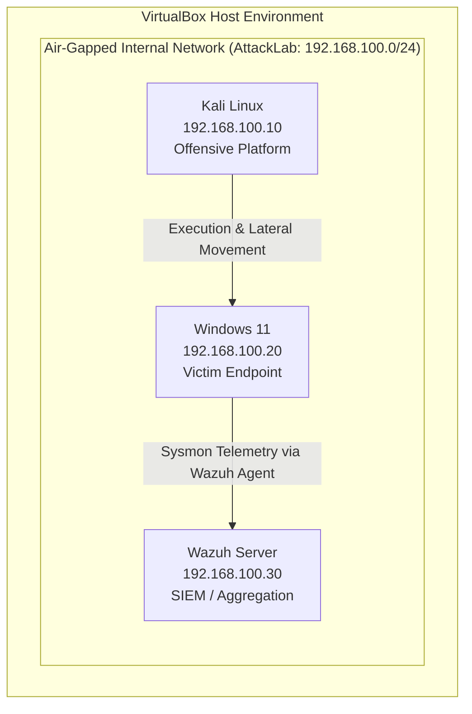

# Laboratory Architecture & Topology

## Executive Overview
This document details the logical and physical architecture of the detection engineering laboratory. The environment utilizes a three-tier virtualized topology deployed on an isolated internal network, facilitating safe exploitation, localized telemetry generation, and centralized log aggregation.

## Hardware Resource Allocation

The laboratory operates on a Type-2 hypervisor (Oracle VM VirtualBox 7) utilizing the following physical host resources:

*   **Host CPU:** Intel Core i5-14400F
*   **Host RAM:** 48GB DDR4 (Active lab footprint: ~14GB)
*   **Storage:** 1TB NVMe SSD
*   **Host OS:** Windows 11 Pro

## Virtual Machine Specifications

The environment consists of three primary virtual machines. NAT interfaces are provisioned strictly for initial dependency installation and are administratively disabled prior to testing.

| Node Role | Hostname / OS | IP Address (Static) | vCPUs | RAM (GB) | Storage | Tools & Agents |
|---|---|---|---|---|---|---|
| **Attacker** | Kali Linux | `192.168.100.10` | 2 | 4 | 40GB | Metasploit, Impacket, Responder, Evil-WinRM |
| **Victim** | Windows 11 Enterprise | `192.168.100.20` | 4 | 6 | 60GB | Sysmon, Sysinternals Suite, Wazuh Agent |
| **SIEM** | Wazuh (Ubuntu 22.04) | `192.168.100.30` | 2 | 4 | 50GB | Wazuh Manager, Elastic Stack |

*Note: Windows Defender is permanently disabled on the Victim node via Safe Mode registry modifications to prevent automated quarantine of testing utilities.*

## Network Topology

All nodes reside on a VirtualBox Internal Network (`AttackLab`) operating on the `192.168.100.0/24` subnet. DHCP is disabled; all routing is handled statically. The environment is entirely air-gapped from the host network and the public internet during active simulations.

## Data Flow & Telemetry Pipeline

1.  **Execution:** Offensive payloads are executed from the Kali Linux node against the Windows 11 victim over the internal subnet.
2.  **Capture:** The Sysmon driver captures process creation, network connections, and memory access events, writing them to the local Windows Event Log.
3.  **Transport:** The Wazuh Agent reads the local event channels and ships the telemetry over TCP/UDP to the Wazuh Manager in near real-time.
4.  **Correlation:** The Wazuh Manager normalizes the data, applies MITRE ATT&CK mapped detection rules, and surfaces actionable alerts to the SIEM dashboard.

## Analysis Methodology

Analysis is conducted at two distinct layers to ensure comprehensive understanding of both raw telemetry and aggregated correlation:

*   **Local Endpoint Triage:** Real-time monitoring utilizing Sysinternals Process Explorer and TCPView, followed by raw event analysis in Windows Event Viewer and Process Monitor captures.
*   **SIEM Correlation:** Alert validation and proactive threat hunting via the Wazuh Discover dashboard utilizing Lucene/KQL syntax.

## Security Controls & Snapshot Strategy

To maintain host safety and ensure reproducible testing baselines, the following isolation controls are enforced:

*   **Host Isolation:** Bi-directional clipboard, drag-and-drop, and shared folders are strictly disabled.
*   **Network Isolation:** NAT adapters are disconnected prior to payload detonation.

**Snapshot Hierarchy:**
Virtual machine states must be captured and documented utilizing a standard naming convention (`YYYY-MM-DD_Hostname_State`) at the following deployment phases:

1.  Base OS Installation (Pre-Configuration)
2.  Sysmon & Sysinternals Staged
3.  Wazuh Agent Registered & Shipping Logs
4.  **Clean Baseline (Pre-Scenario)** - *Primary rollback target*

## Future Architectural Expansion

The laboratory topology is designed for modular scalability. Planned expansions to facilitate advanced detection scenarios include:

*   **Active Directory Domain Services:** Addition of a Windows Server 2022 Domain Controller to simulate Kerberos abuse and lateral movement.
*   **Digital Forensics Node:** Integration of a REMnux workstation on a mirrored SPAN port configuration for localized malware reversing and network traffic analysis.
